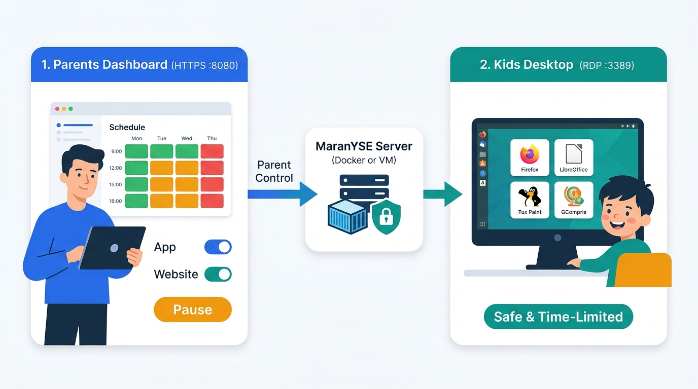
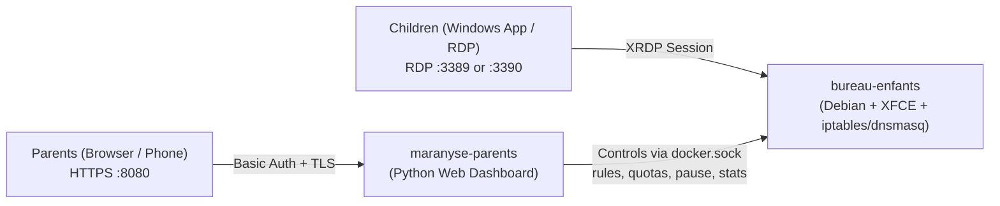
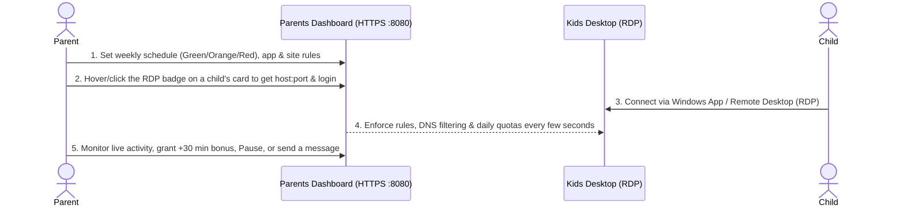
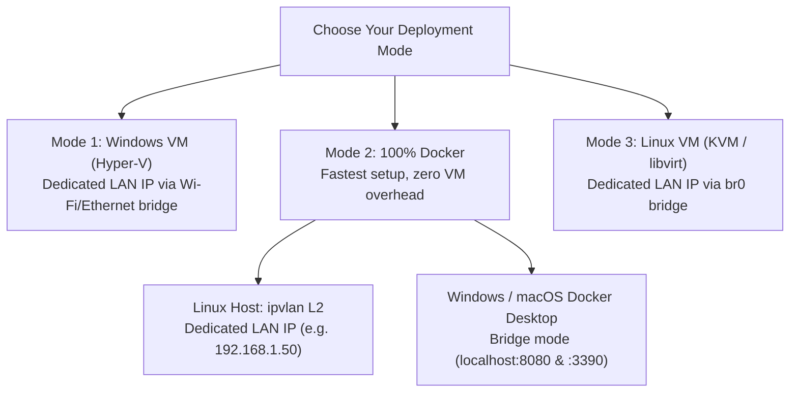

# MaranYSE — Parental Control & Multi-Session Kids Desktop

[](LICENSE)


**MaranYSE** provides an isolated, multi-user Linux desktop environment (XFCE, Firefox, LibreOffice, GCompris, Tux Paint, Thonny) accessed over **Remote Desktop (RDP)** and managed in real time from an **HTTPS web dashboard** built for parents.

---

## Quick Start (Docker)

Deploy MaranYSE in minutes without creating a virtual machine.

### Windows (Docker Desktop)

```powershell
git clone https://github.com/elhajjaji/maranyse.git
cd maranyse\deploy\docker
copy .env.example .env
# Edit .env to set MARANYSE_LOGIN and MARANYSE_PASSWORD
docker compose -f docker-compose.windows.yml up -d --build
```

- **Parents Dashboard**: `https://localhost:8080`
- **Kids Desktop (RDP)**: `127.0.0.1:3390` *(or check the **RDP** tooltip on each child's card)*

### Linux Host (Dedicated LAN IP via `ipvlan` L2)

```bash
git clone https://github.com/elhajjaji/maranyse.git
cd maranyse/deploy/docker
cp .env.example .env
# Edit .env: set MARANYSE_LAN_IP (e.g. 192.168.1.50), MARANYSE_LAN_IFACE, MARANYSE_LOGIN, MARANYSE_PASSWORD
docker compose up -d --build
```

- **Parents Dashboard**: `https://<MARANYSE_LAN_IP>:8080`
- **Kids Desktop (RDP)**: `<MARANYSE_LAN_IP>:3389`

---

## Key Features

- **Per-Child Isolated Sessions**: Dedicated Linux accounts with separate home directories (`noexec` enforced when enabled), per-user `iptables` + `dnsmasq` DNS filtering, and independent screen-time tracking.
- **Minute-Precision Weekly Schedule**:
  - **Green (Full Access)**: Unrestricted desktop and internet access.
  - **Orange (Restricted Access)**: Allowed apps & websites only, with daily per-app/per-site time quotas.
  - **Red (Locked)**: No login allowed; active sessions receive a 1-minute warning before automatic logout.
- **Live Parent Controls**: Instant **Pause** (locks keyboard/mouse without closing open work), **+30 min Bonus**, **Send Message** popup, **Force Logout**, and **RDP connection tooltip** (`host:port` + username) directly on each child's card.
- **Built-in App & Language Management**: Install/remove curated educational or coding apps (e.g., VS Code, Scratch) and set per-child desktop languages (10+ languages supported).
- **3 Flexible Deployment Modes**: Windows Hyper-V VM, 100% Docker (Linux `ipvlan` L2 dedicated LAN IP or Windows Docker Desktop), or Linux KVM/libvirt VM.

---

## How MaranYSE Works



### Architecture



### Daily Usage Workflow



---

## Quick Start Guide (Using the App)

1. **Open the Parents Dashboard**:
   - Navigate to `https://<HOST_OR_LAN_IP>:8080` in your browser and accept the self-signed certificate (or install it from the **Help** page).
   - Sign in with `MARANYSE_LOGIN` / `MARANYSE_PASSWORD` configured in your `.env` (Docker) or `config.env` (VM).
2. **Check Child Credentials & RDP Address**:
   - Go to **Home** or **Accounts** (`Comptes`).
   - Hover or click the **RDP** pill on any child's card to copy the exact **Address (`host:port`)** and **Username**.
   - View or change the child's password from the **Accounts** page (or `•••` menu on Home).
3. **Connect a Child via RDP (Windows App / Remote Desktop)**:
   - Open **Windows App** (or `mstsc.exe`), add a PC with the address shown in the **RDP** tooltip (e.g. `192.168.1.50:3389` on Linux Docker/VM, or `127.0.0.1:3390` on Windows Docker Desktop).
   - Sign in with the child's username (`driss`, `paul`, `carole`, or any account you added) and password.
4. **Configure Rules & Schedules**:
   - **Planning**: Paint 15-minute blocks across the week in **Green**, **Orange**, or **Red**.
   - **Rules**: Choose which websites and applications are blocked or time-limited during **Orange** hours.
   - **Stats**: View daily/weekly screen time per child, top apps, and visited domains.

---

## 3 Deployment Modes



### Mode 1 — Windows VM (Hyper-V)
1. Copy `deploy/vm-common/config.env.example` to `deploy/vm-common/config.env` and customize if needed.
2. Create the Debian VM (Administrator PowerShell):
   ```powershell
   powershell -ExecutionPolicy Bypass -File deploy\vm-windows\creer_vm.ps1
   ```
3. Deploy MaranYSE (Git Bash):
   ```bash
   bash deploy/vm-common/installer_controle.sh
   ```
- **Parents Dashboard**: `https://<VM_IP>:8080`
- **Kids Desktop (RDP)**: `<VM_IP>:3389`

### Mode 2 — 100% Docker

#### Option A: Linux Host (Dedicated LAN IP via `ipvlan` L2)
Gives `bureau-enfants` and `maranyse-parents` their own IP address on your home network, distinct from the host machine:
```bash
cd deploy/docker
cp .env.example .env   # set MARANYSE_LAN_IP (e.g. 192.168.1.50), MARANYSE_LAN_IFACE, MARANYSE_LOGIN, MARANYSE_PASSWORD
docker compose up -d --build
```
- **Parents Dashboard**: `https://<MARANYSE_LAN_IP>:8080`
- **Kids Desktop (RDP)**: `<MARANYSE_LAN_IP>:3389`

#### Option B: Docker Desktop on Windows / macOS (`bridge` + port forwarding)
```powershell
cd deploy/docker
copy .env.example .env
docker compose -f docker-compose.windows.yml up -d --build
```
- **Parents Dashboard**: `https://localhost:8080`
- **Kids Desktop (RDP)**: `127.0.0.1:3390` *(port `3390` is used by default to avoid conflicting with Windows' built-in RDP service on `3389`)*

### Mode 3 — Linux VM (KVM / libvirt)
1. Copy `deploy/vm-common/config.env.example` to `deploy/vm-common/config.env` (set `MARANYSE_BRIDGE=br0`).
2. Create the Debian 12 VM bridged to your LAN:
   ```bash
   bash deploy/vm-linux/creer_vm_linux.sh
   ```
3. Set `MARANYSE_VM_IP` in `deploy/vm-common/config.env`, then deploy:
   ```bash
   bash deploy/vm-common/installer_controle.sh
   ```
- **Parents Dashboard**: `https://<VM_IP>:8080`
- **Kids Desktop (RDP)**: `<VM_IP>:3389`

---

## Project Structure

| Directory | Purpose |
|---|---|
| `app/` | Parents web dashboard source (`tableau.py`, `logique.py`, `style.py`, `i18n/`, `assets/`, `Dockerfile`) |
| `bureau/` | Base OS image for the kids desktop (`Dockerfile`, `entrypoint.sh`, `logiciels.sh`, `firefox-net.c`, `sans-internet*.c`, `xfce/`) |
| `deploy/docker/` | Docker Compose setups (`docker-compose.yml`, `docker-compose.windows.yml`, `.env.example`) |
| `deploy/vm-windows/` | Hyper-V scripts for Windows hosts (`creer_vm.ps1`, `charge_hote.ps1`, diagnostics) |
| `deploy/vm-linux/` | KVM/libvirt script for Linux hosts (`creer_vm_linux.sh`) |
| `deploy/vm-common/` | Shared VM provisioning & maintenance scripts (`installer_controle.sh`, `installer_tableau.sh`, `config.env.example`) |
| `docs/` | Documentation assets & illustrations |
| `tests/` | Automated end-to-end & i18n tests |

---

## Security & Local Secrets

- Secrets (`deploy/vm-common/build/`, `deploy/vm-common/seed/`, `deploy/vm-common/config.env`, `.env`, `deploy/docker/.env`) are excluded via `.gitignore` and never committed.
- Parent credentials in Docker mode are read from `MARANYSE_LOGIN` and `MARANYSE_PASSWORD` in `deploy/docker/.env`.

## License

Licensed under the [Apache License 2.0](LICENSE). Copyright 2026 AbdERRAHMAN EL HAJJAJI.
